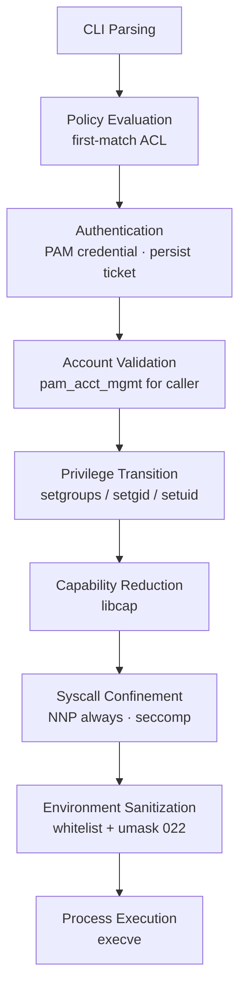

<div align="center">

# Voix

**Privilege Policy Enforcement Runtime**

[](https://github.com/Veridian-Zenith/Voix/actions/workflows/tests.yml)
[](https://github.com/Veridian-Zenith/Voix/actions/workflows/codeql.yml)
[](https://github.com/Veridian-Zenith/Voix/releases)
[](https://aur.archlinux.org/packages/voix)
[](./LICENSE)

Voix is a user-space Privilege Policy Enforcement Runtime designed to evaluate
authorization policies, construct controlled execution contexts, and enforce
privilege and syscall-level boundaries during command execution on Unix-like
systems.

It operates as a deterministic execution broker between user intent and
privileged system operations. While it may provide compatibility with
`sudo`-like workflows, it is architecturally distinct from traditional privilege
escalation utilities and is not intended as a drop-in wrapper.

</div>

---

## Table of Contents

- [1. System Model](#1-system-model)
- [2. Core Responsibilities](#2-core-responsibilities)
- [3. Execution Tiers](#3-execution-tiers)
- [4. Security Model](#4-security-model)
- [5. Configuration Model](#5-configuration-model)
- [6. Authentication Model](#6-authentication-model)
- [7. Design Constraints](#7-design-constraints)
- [8. Compatibility Note](#8-compatibility-note)
- [9. Build and Installation](#9-build-and-installation)
- [10. Usage](#10-usage)
- [11. CLI Reference](#11-cli-reference)
- [12. Documentation](#12-documentation)
- [13. Troubleshooting](#13-troubleshooting)
- [14. License](#14-license)

---

## 1. System Model

Voix implements a staged execution pipeline for privileged command invocation:



Each stage is strictly ordered and failure-atomic where applicable. Any violation of required invariants results in termination prior to execution.

> [!NOTE]
> All identity resolution happens **before** `fork()`; the child performs no
> name-service lookups between `fork()` and `execve()`.

---

## 2. Core Responsibilities

Voix is responsible for:

- Evaluating structured authorization policies (YAML-based ACL model)
- Determining whether an execution request is permitted
- Constructing a constrained execution context for permitted operations
- Applying privilege transitions and security hardening based on target execution tier
- Delegating authentication to PAM where required
- Enforcing syscall and capability restrictions for non-privileged execution targets
- Executing the final binary within the prepared context

Voix does not interpret shell logic, provide a scripting environment, or manage long-lived sessions beyond optional authentication persistence mechanisms.

---

## 3. Execution Tiers

Voix defines two primary execution tiers, selected by the target identity and the matched rule's `profile:`.

| | **Privileged target** | **Non-privileged target** |
| :--- | :--- | :--- |
| **Selected for** | `core.unconfined_targets`, or an explicit `profile: privileged` | Everything else |
| **Capabilities** | Full Linux capabilities retained | All capabilities dropped |
| **No-new-privs** | Not applied | `PR_SET_NO_NEW_PRIVS` enforced |
| **Seccomp** | No filtering applied | Syscall blacklist applied |
| **Resource limits** | None imposed by Voix | `RLIMIT_*` policies enforced |
| **Environment** | Preserved verbatim for unconfined targets | Sanitized to a restricted whitelist |
| **Inherited FDs** | Not closed | Closed except the pinned executable (fd 3) |
| **Rationale** | Compatibility with system-level operations | Least privilege |

> [!NOTE]
> The non-privileged environment is rebuilt from a whitelist unless the
> matched rule grants `keepenv`. `keepenv` preserves the caller's variables
> minus known loader/interpreter names; it is the only grant that enables
> preservation.

---

## 4. Security Model

Voix follows a defense-in-depth model consisting of:

- Policy-driven authorization (ACL evaluation)
- System authentication delegation (PAM integration)
- Privilege separation via the fork/exec transition
- Capability reduction via `libcap`
- Syscall filtering via `libseccomp`
- Environment sanitization to eliminate injection vectors
- Explicit denial of privilege-escalation paths after the transition

The security boundary is enforced at process creation time and is not dynamically adjusted after execution begins.

---

## 5. Configuration Model

Voix uses a structured YAML configuration file (`/etc/voix.conf`) to define execution policy. Configuration is divided into three sections:

| Section | Purpose |
| :--- | :--- |
| `core` | Execution environment parameters (trusted paths, sanctuary, unconfined targets) |
| `acl` | Authorization rules for users and groups |
| `security` | Named profiles and the global blocklist |

Policies are evaluated deterministically and matched against: user identity, group membership, the requested command path, and optional argument constraints.

<details>
<summary><b>Configuration example</b></summary>

For the full annotated example, see [config/voix.conf](config/voix.conf) — the canonical, installed copy.

```yaml
# Voix configuration
core:
  sanctuary: /var/lib/voix
  paths:
    - /bin
    - /sbin
    - /usr/bin
    - /usr/sbin
  # Empty by default: unconfined targets bypass most confinement.
  unconfined_targets: []

# Empty by default: a fresh install permits nothing.
acl:
  user: {}
  group: {}

security:
  profiles:
    restricted:
      retain_full_capabilities: false
      enable_seccomp: true
      enable_resource_limits: true
      scrub_environment: true
    privileged:
      retain_full_capabilities: true
      enable_seccomp: false
      enable_resource_limits: false
      scrub_environment: false
  blocklist:
    - /bin/sh
```

`scrub_environment` is accepted for compatibility but currently has no effect;
environment behavior is controlled by `preserve_full_environment` and `keepenv`.

</details>

> [!WARNING]
> The shipped sample is **closed by default**: no user or group is trusted,
> no target is unconfined, and the ACL contains no permits. Add only the rules
> you need, then validate the result with `voix --check-config`.

---

## 6. Authentication Model

Authentication is delegated to the system PAM stack under the `voix` service context. A credential check is required unless one of the following applies:

- the matched rule carries `trust`/`nopass`;
- the invoking user is root;
- a fresh `persist` ticket exists for the **caller/target UID pair** and the matched rule carries `persist`.

Tickets are consulted before `-n` rejects an invocation, so a non-interactive
run can reuse an existing ticket but can never prompt. Only a successful
`pam_authenticate()` mints or refreshes a ticket; trust/nopass/root skips and
reused tickets never do.

Voix does not implement its own credential storage or verification system; `persist` stores only a timestamp.

> [!IMPORTANT]
> `pam_acct_mgmt` runs for the **invoking user** on every invocation,
> including `trust`/`nopass` paths, so an expired or disabled caller is
> denied. The **target account** is validated separately with its own PAM
> handle. That target account check is not credential verification and is
> never treated as proof that the target's password was checked.
> See [Known Limitations](THREATS.md#7-known-limitations).

---

## 7. Design Constraints

- Implemented in C++26
- Built exclusively with the LLVM/Clang toolchain
- Minimal external dependency surface
- Deterministic policy evaluation
- No dynamic plugin execution model
- No embedded shell interpreter

---

## 8. Compatibility Note

Voix may be used in workflows similar to `sudo` or `doas` for operational familiarity. However, this is a compatibility layer of usage, not a reflection of its internal architecture or design intent. Voix does not implement the full `sudo`/`doas` command-line surface; the `provides`/`conflicts` entries in the AUR packages exist for dependency resolution, not as a claim of CLI equivalence.

---

## 9. Build and Installation

### Prerequisites

| Requirement | Notes |
| :--- | :--- |
| **LLVM/Clang** | Clang 22+; GCC is not supported |
| **CMake** | v3.30+ (C++26 standard features) |
| **Ninja** | Build generator |
| **`yaml-cpp`, `pam`** | Required runtime/development dependencies |
| **`libcap`, `libseccomp`** | Optional (default `ON`) |

### Build Instructions

1. **Clone the repository**:

    ```bash
    git clone https://github.com/Veridian-Zenith/Voix.git && cd Voix
    ```

2. **Configure and build**:

    ```bash
    cmake -B build -G Ninja -DCMAKE_EXPORT_COMPILE_COMMANDS=ON -DCMAKE_INSTALL_PREFIX=/usr -DCMAKE_BUILD_TYPE=Release
    ninja -C build -j$(nproc)
    ```

3. **Install** (required for the setuid bit):

    ```bash
    sudo cmake --install build
    ```

### Distribution Specifics

- **Arch Linux**: install from the AUR — `paru -S voix` or `yay -S voix`.
- **Other distributions**: see [packaging/](packaging/) for guidance.

---

## 10. Usage

After installation, ensure the PAM configuration at `/etc/pam.d/voix` is aligned with your security policy. The shipped `/etc/voix.conf` is closed by default — no ACL permits and no unconfined targets — so add only the rules you need and validate with `voix --check-config`.

```bash
voix <command> [args...]
```

The most common flags are `-u`, `-n`, `-k`, `-C`, and `-l`; the full table is in [CLI Reference](#11-cli-reference), and `voix --help` prints the built-in summary.

---

## 11. CLI Reference

| Flag | Long form | Description |
| :--- | :--- | :--- |
| <kbd>-h</kbd> | `--help` | Show help |
| <kbd>-v</kbd> | `--version` | Show version |
| <kbd>-C</kbd> `FILE` | `--config` | Configuration file (default `/etc/voix.conf`); must be a regular root-owned file with no group/world write bits |
| <kbd>-c</kbd> | `--check-config` | Validate the configuration file |
| <kbd>-E</kbd> | `--preserve-env` | Accepted for compatibility; has no effect. Environment preservation is enabled by a `keepenv` rule |
| <kbd>-H</kbd> | `--home` | Set `HOME` to the target user's home directory. Without it, `HOME` is not set to the target's home |
| <kbd>-i</kbd> | `--login` | Run via the target's login shell. Forces `HOME` and `SHELL` to the target's values, even with `keepenv` or an unconfined target |
| <kbd>-k</kbd> | | Invalidate all persisted authentication tickets for the invoking user |
| <kbd>-l</kbd> | `--list` | List permit rules for the current user (deny-aware for identical scope) |
| <kbd>-n</kbd> | | Non-interactive mode; reuse a valid persisted ticket if one exists, otherwise fail rather than prompt |
| <kbd>-s</kbd> | | Execute the invoking user's `$SHELL` (not the target's login shell) |
| <kbd>-u</kbd> `USER` | | Execute as a specific target user (default: `root`) |
| | `--run-tests` | Run the built-in test suite (testing builds only) |

See [docs/CLI.md](docs/CLI.md) for the full reference, including stable exit codes and logging behavior.

---

## 12. Documentation

Consult the following technical guides:

| Document | Content |
| :--- | :--- |
| [THREATS.md](THREATS.md) | Threat model, TCB metrics, system architecture, syscall filtering, known limitations |
| [CONTRIBUTING.md](CONTRIBUTING.md) | Build, lint, and test workflow; roadmap and design decisions |
| [docs/CLI.md](docs/CLI.md) | Command-line interface and flag specifications |
| [docs/CONFIG.md](docs/CONFIG.md) | Detailed guidance on `/etc/voix.conf` |
| [docs/SUDO.md](docs/SUDO.md) | `sudo`/`doas` compatibility guide and caveats |
| [packaging/README.md](packaging/README.md) | Distribution and AUR packaging |

---

## 13. Troubleshooting

<details>
<summary><b>"PAM authentication failed"</b></summary>

Verify that the PAM configuration at `/etc/pam.d/voix` matches your system's
authentication stack (most distributions can `include system-auth`). Account-level
failures for the invoking user (expired password, locked account) are also reported
here — `pam_acct_mgmt` runs even for `trust` rules.

</details>

<details>
<summary><b>"Permission denied"</b></summary>

Check the user/group authorization rules in `/etc/voix.conf`. Remember that rules
without a `target:` field only apply to the default target (`root`); switching
users requires an explicit `target: USER` rule. Validate your policy with
`voix -c`.

</details>

<details>
<summary><b>"Insufficient privileges" at startup</b></summary>

The binary must be setuid root (mode `4755`) or carry equivalent file
capabilities. Reinstall with `sudo cmake --install build`.

</details>

---

## 14. License

Voix is distributed under the Open Software License v3.0 (OSL-3.0). See [LICENSE](LICENSE) for details.
