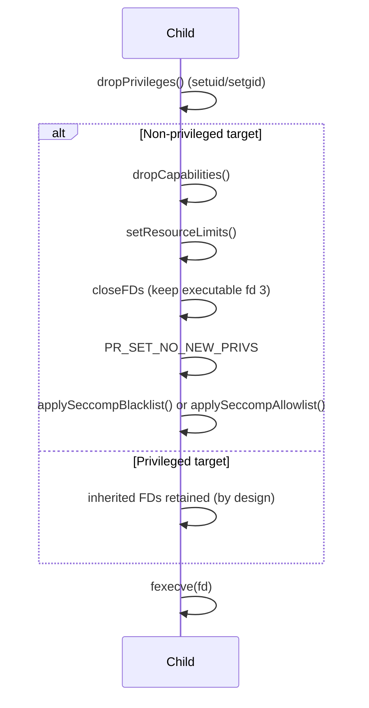

# Threat Model and Security Architecture

Voix is a Privilege Policy Enforcement Runtime designed as a policy-driven alternative to traditional privilege escalation tools, with a more transparent, minimal, and strictly controlled security model. This document outlines the attack surface, the threat model, and the technical mitigations implemented to ensure system integrity.

> [!IMPORTANT]
> This document describes the implemented behavior of `4.14.0-beta.1` (a
> test/beta build; `4.13.3` is the last release). Where a control has a known
> limitation, it is called out inline and summarized in
> [Known Limitations](#7-known-limitations). The test suite (`tests/`, 121
> tests) covers policy, configuration, path, ticket, catastrophic-command
> logic, and an unprivileged end-to-end execution path (fork, FD scrub,
> seccomp, `fexecve`); it does not exercise PAM or the privileged setuid
> transition end-to-end.

## Table of Contents

- [1. Trusted Computing Base](#1-trusted-computing-base)
- [2. Threat Model](#2-threat-model)
- [3. Attack Surface Analysis](#3-attack-surface-analysis)
- [4. System Architecture](#4-system-architecture)
- [5. Technical Defenses](#5-technical-defenses)
- [6. Summary Comparison](#6-summary-comparison)
- [7. Known Limitations](#7-known-limitations)

---

## 1. Trusted Computing Base

To ensure transparency and auditability, Voix maintains a minimal TCB. Unlike traditional tools that have grown complex over decades, Voix is designed for a narrow, high-assurance scope.

| Metric | Traditional Tools (approx.) | Voix | Note |
| :--- | :--- | :--- | :--- |
| **Lines of Code** | ~180,000 | **5,289** (`src/*.cpp`: 3,653 + `include/*.hpp`: 1,636; `4.14.0-beta.1`) | ~34x smaller attack surface |
| **Test Suite** | varies | 2,988 lines, 121 tests incl. adversarial and unprivileged end-to-end cases | Ships with the repo |
| **External Dependencies** | Many (varies) | 2 required, 2 optional | `yaml-cpp`, `pam` (required); `libcap`, `libseccomp` (optional) |
| **Binary Size (Release)** | ~1.2 MB | **511 KB** distro (dynamic `yaml-cpp`) / **794 KB** portable `voix-bin` (bundled) — x86_64 v4.13.3, both stripped; compressed packages 236 KB / 340 KB | Clang `-O2` + ThinLTO + ICF + `--gc-sections` + `--strip-all`; bundling `yaml-cpp` costs ~283 KB but removes the `libyaml-cpp.so.N` soname requirement |
| **Config Language** | Sudoers (custom) | YAML (standard) | Reduced parsing complexity |
| **CVE History** | Extensive | None published to date | A short history is not evidence that no bugs remain |

<details>
<summary>How these numbers are produced</summary>

```bash
# Source lines (implementation + headers, excluding tests)
wc -l src/*.cpp include/*.hpp | tail -1

# Test suite size
wc -l tests/*.cpp tests/*.hpp | tail -1

# Stripped release binary size
cmake -B build -G Ninja -DCMAKE_BUILD_TYPE=Release && ninja -C build -j$(nproc)
ls -la build/voix

# Packaged sizes (from the AUR PKGBUILDs)
cd pkg/voix && makepkg -s && ls -la *.pkg.tar.zst                 # distro build
cd ../voix-bin && makepkg -s && ls -la *.pkg.tar.zst             # portable build
# Installed size is the `size =` field inside the package's .PKGINFO
```

</details>

## 2. Threat Model

The primary threat actor is a **local authenticated user** attempting to gain unauthorized root privileges or execute privileged operations beyond their assigned scope.

### Attack Vectors

| Vector | Primary Mitigation | Defense-in-Depth |
| :--- | :--- | :--- |
| Configuration tampering | Root ownership + `O_NOFOLLOW` fd-based read | Symlink rejection, group/world write-bit rejection |
| Binary exploitation | Hardened build (PIE, RELRO, CET, stack-protector) | Minimal TCB, modern C++26 toolchain |
| Authentication bypass | PAM credential check unless `trust`/`nopass`, root caller, or a valid caller/target `persist` ticket | Echo-controlled conversation, zeroed buffers, separate caller and target account validation |
| Command injection | `fexecve()` on a pinned inode (no shell), environment sanitization | Catastrophic-command detection, canonicalized blocklist |
| Kernel exploitation | seccomp blacklist for non-privileged targets | Unconditional `PR_SET_NO_NEW_PRIVS` below privileged tier |
| Signal-based attacks | `pthread_sigmask(SIG_BLOCK)` around `fork()` | Child resets all handlers to `SIG_DFL` |
| Audit-log forgery | Control-character escaping in log writer | Symlink-resistant `O_NOFOLLOW\|O_APPEND` opens |
| Timestamp-ticket tampering | Owner/mode verified on open fd, future timestamps rejected | Tickets live in a root-only `0700` directory |

## 3. Attack Surface Analysis

### The Configuration File (`/etc/voix.conf`)
The configuration file defines the entire security policy. If a user can write to this file, they effectively own the system.

- **Risk**: YAML parsing vulnerabilities in `yaml-cpp`; unauthorized modification; symlink swaps.
- **Mitigation**:
    - **Strict Ownership**: root-owned file *and* effective-UID check performed on the opened descriptor.
    - **Strict Permissions**: group- and world-writable files are rejected.
    - **Trusted Path**: for `-C`, every path component must be absolute, root-owned, free of symlinks, and not group/world writable. This prevents a root-owned file in an attacker-controlled directory from being selected.
    - **TOCTOU-Safe Read**: `open(O_NOFOLLOW)` + `fstat()` verification + single-fd read loop — the parsed bytes provably come from the verified inode.

> [!WARNING]
> Upgrades never overwrite a live configuration: the installer writes
> `/etc/voix.conf.new` instead and leaves the administrator's policy intact.

### The Setuid Binary
To transition from a standard user to root, Voix must be installed as setuid root.

- **Risk**: Memory-safety issues (buffer overflows, use-after-free) in C++ code.
- **Mitigation**:
    - **Modern Toolchain**: Clang 22+, LLD, ThinLTO, C++26.
    - **Hardening Flags**: `-fstack-protector-strong`, `-fstack-clash-protection`, `-D_FORTIFY_SOURCE=3`, `-fcf-protection=full`, `-ftrivial-auto-var-init=zero`, `-fstrict-flex-arrays=3`, `-ffunction-sections`/`-fdata-sections` + `--gc-sections`, PIE + full RELRO (+ `pack-relative-relocs`).
    - **Minimal Dependencies**: limited external libraries to reduce the TCB.

### PAM Authentication
Voix delegates authentication to the system's PAM configuration.

- **Risk**: PAM conversation hijacking; failure to clean up session credentials; account-state bypass.
- **Mitigation**:
    - **Explicit Lifecycle**: `start` → `authenticate` → `acct_mgmt` → `setcred` → `open_session` → `close_session`.
    - **Caller Account Validation Always Runs**: `pam_acct_mgmt` validates the invoking user on every invocation, including `trust`/`nopass` paths.
    - **Sensitive Data Handling**: terminal echo disabled around prompts; password buffers zeroed via volatile writes with a compiler barrier.
    - **Session Hygiene**: an RAII guard closes the PAM session even when command execution throws.

> [!IMPORTANT]
> The caller's account is validated with `pam_acct_mgmt` on every invocation,
> including trust/nopass paths. The target account is validated separately
> with its own PAM handle. Target account validation is **not** credential
> verification and is never treated as proof that the target's password was
> checked. There is no passwordless-target bypass: unless the rule grants
> trust/nopass, the caller is root, or a valid persisted ticket exists, the
> caller must pass `pam_authenticate()`.

### Persisted Authentication Timestamps (`persist`)
- **Risk**: attackers pre-planting or tampering with ticket files to inherit a session.
- **Mitigation**:
    - Tickets live under `<sanctuary>/timestamp/<caller-uid>-<target-uid>`. The timestamp directory is created and forced to mode `0700`, owned by the effective UID; ticket files are created with mode `0600`. Tickets are scoped to the caller/target UID pair, so a ticket for one target cannot be replayed against another.
    - Ticket files are written/read exclusively through `O_NOFOLLOW` descriptors with owner and write-bit verification.
    - Future-dated tickets (clock skew or tampering) are rejected; TTL is 15 minutes.
    - `voix -k` removes all of the invoking user's tickets on demand.
    - A ticket is recorded **only** after a successful `pam_authenticate()`. Trust/nopass/root skips and reused tickets never mint or refresh a ticket.
    - `-n` consults a valid ticket before rejecting the invocation: it can reuse an existing ticket but can never prompt.

### Signal Handling & Privilege Transition
A critical window of vulnerability exists between `fork()` and `fexecve()`.
- **Risk**: signal-based attacks interrupting the transition.
- **Mitigation**:
    - **Atomic Signal Blocking**: `pthread_sigmask(SIG_BLOCK)` blocks all signals before `fork()`; the privilege transition is uninterruptible.
    - **Handler Reset**: the child explicitly resets every handler to `SIG_DFL` before executing the target command.
    - **No NSS After Fork**: target identity (UID/GID/groups/home/shell) is fully resolved *before* `fork()`; the child performs no name-service lookups that could deadlock on inherited locks.

### Environment Sanitization
Environment variables (like `LD_PRELOAD` or `BASH_ENV`) are classic vectors for privilege escalation.
- **Risk**: shell escapes or library injection via the inherited environment.
- **Mitigation**:
    - **Strict Whitelisting**: by default the environment is dropped and only `TERM`, `DISPLAY`, `XAUTHORITY`, `LANG`, `PATH` survive, with `PATH` overridden to trusted directories. A `keepenv` grant preserves the caller's other variables (minus the dangerous names below).
    - **Dangerous Name/Prefix Filtering**: even `keepenv` runs strip `BASH_ENV`, `ENV`, `IFS`, `CDPATH`, `GCONV_PATH`, `GETCONF_DIR`, `HOSTALIASES` and any `LD_*`, `CC`, `CXX`, `CMAKE_`, `PERL*`, `PYTHON*`, `RUBY*` variable.
    - **Policy-Gated Preservation**: `keepenv` is the only grant that enables environment preservation. The CLI `-E` flag is accepted for compatibility but ignored.
    - **Forced umask**: the child sets `umask(022)` so callers cannot influence file modes of privileged operations.
    - **Explicit Identity Setting**: `USER` and `LOGNAME` come from the resolved target identity. `HOME` is set from the target when `-H` is given, and `HOME`/`SHELL` are always forced for login shells (`-i`), even with `keepenv` or an unconfined target. This prevents a target login shell from reading caller-owned startup files.

### Command Execution
Once authenticated, Voix executes the target command with elevated privileges.
- **Risk**: catastrophic commands, PATH hijacking, argument trickery.
- **Mitigation**:
    - **Catastrophic Detection** (hardcoded): basename-matched destruction tools (`fdisk`, `sfdisk`, `cfdisk`, `parted`, `wipe`, `wipefs`, `shred`, `mkswap`, `mkfs*` family), `dd` to raw block devices (sd/hd/vd/nvme/mmcblk/dm/mapper/disk aliases/root device), and `rm -rf` variants targeting `/` — including globs, long options, combined short flags, and cwd-relative paths that canonicalize to `/`.
    - **Configurable Blocklist**: exact-path entries plus `regex:` patterns matched against the canonicalized command line.
    - **Universal Root-Owned Resolution**: every requested command — bare name, relative path, or absolute path — is canonicalized and must be a regular file owned by `root` with no group/world write bits, verified via `O_NOFOLLOW` + `fstat`.
    - **Pinned Execution**: the validated device/inode pair is re-checked on the opened descriptor, which is preserved across descriptor scrubbing (moved to fd 3 on the restricted tier) and executed with `fexecve(2)`. Replacing the path after validation cannot change which file runs.
    - **Canonical ACL and Blocklist Matching**: ACL rules and exact blocklist entries compare the policy path (directory symlinks resolved, final component preserved) so merged-`/usr` aliases match without collapsing multicall applets.

> [!NOTE]
> **Catastrophic detection is hardcoded and runs before policy evaluation
> for the command Voix is asked to execute.** No ACL rule, group membership,
> or profile setting can permit a directly requested blocked tool. The gate
> does not inspect commands launched by a permitted shell or interpreter, so
> a shell can still invoke those tools. For direct Voix requests, running
> them requires a shell already authenticated as root — TTY login, `su -`,
> or bare `-i`. See
> [`docs/SUDO.md`](docs/SUDO.md#3-destructive-operations-require-a-direct-root-login).

> [!NOTE]
> Exact-path blocklist entries are canonicalized before comparison. An entry
> of `/bin/sh` therefore also blocks `/usr/bin/sh` on merged-`/usr` systems
> and alternate spellings such as `/usr/bin/./bash` or `/bin/../bin/sh`.
> The final component is preserved so multicall applets remain distinct.
> Use `regex:` entries when the policy intent is to match a tool by arguments
> or a broader path pattern.

---

## 4. System Architecture

### Module Overview

| Module | Class | Role |
| :--- | :--- | :--- |
| `voix.hpp/cpp` | `Voix` | Main orchestrator: config load, auth, permission, execution, audit gating (`nolog`) |
| `command.hpp/cpp` | `Command` | Fork/exec engine, privilege transition (pre-fork identity), env sanitization, profile resolution |
| `config.hpp/cpp` | `Config` | YAML config loading, rule parsing, security profiles, exact + `regex:` blocklist |
| `security.hpp/cpp` | `Security` | User validation, catastrophic commands, capabilities, seccomp blacklist |
| `authenticator.hpp/cpp` | `PamAuthenticator` | PAM lifecycle (caller and target `acct_mgmt`), credential modes, persisted tickets |
| `ticket_store.hpp/cpp` | `TicketStore` | TOCTOU-hardened caller/target-scoped authentication tickets under `<sanctuary>/timestamp/` |
| `permission_checker.hpp/cpp` | `PermissionChecker` | ACL rule evaluation, UID/GID matching, pattern matching, deny-aware listing |
| `rule.hpp` | `Rule` | Data model for authorization rules (incl. `envlist`, `nolog`, `persist`, `pattern`) |
| `file_utils.hpp/cpp` | `FileUtils` | Secure file I/O (`O_NOFOLLOW` reads/writes, private directories), path validation, command resolution |
| `logger.hpp/cpp` | `Logger` | Audit logging to `/var/log/voix.log` and syslog with control-character escaping and stable event codes |
| `policy_analyzer.hpp/cpp` | `PolicyAnalyzer` | Semantic policy linting for `--check-config` |
| `pam_utils.hpp/cpp` | `pam_conversation` | PAM conversation with echo control |
| `system_identity.hpp/cpp` | `SystemIdentity` | System identity lookups (testable abstraction) |
| `system_utils.hpp/cpp` | `SystemUtils` | UID/GID resolution, passwd lookups, environment helpers |

### Execution Flow (Child Process)

```mermaid
flowchart TB
    P[Parent: resolve executable<br/>canonicalize · root-owned · pin inode] --> F[fork · signals blocked]
    F --> C1[Restore signal mask<br/>reset handlers to SIG_DFL]
    C1 --> C2["umask(022)"]
    C2 --> C3[setgroups/setgid/setuid<br/>identity resolved pre-fork]
    C3 --> C4{Privileged tier?}
    C4 -- yes --> C7
    C4 -- no --> C5[Drop all capabilities]
    C5 --> C6[Resource limits<br/>fail-closed]
    C6 -.-> C7[clearenv + rebuild<br/>PATH/USER/LOGNAME (+HOME with -H) + rule envlist]
    C6 --> C8[Close inherited FDs 4+<br/>keep pinned executable as fd 3]
    C7 --> C8
    C8 --> C9["PR_SET_NO_NEW_PRIVS<br/>+ seccomp blacklist"]
    C9 --> C10["fexecve(fd) on the validated inode<br/>login shells via argv[0] dash convention"]
```

> [!NOTE]
> Capability drop, resource limits, FD closing and seccomp apply only to the
> **non-privileged tier**. Privileged targets (package-manager workflows)
> retain full capabilities, an unrestricted syscall surface and their
> inherited environment by design.

### Design Patterns

- **Interface abstraction** (`IAuthenticator`, `IIdentity`) for dependency injection and test mocking
- **RAII wrappers** for `cap_t` (`UniqueCap`) and `seccomp_filter_ctx` (`UniqueSeccomp`)
- **`std::expected<T, E>`** for type-safe error handling in file operations
- **`std::ranges`** for modern C++ algorithm usage
- **First-match semantics** for ACL rule evaluation

---

## 5. Technical Defenses

### Linux Capabilities (`libcap`)
Voix employs the principle of least privilege using Linux capabilities for non-privileged targets.
- **Non-Privileged Targets**: all capabilities are stripped via `Security::dropCapabilities()` before the target command executes — zero inherited root powers.
- **Privileged Targets** (root, package manager): full capabilities are retained since voix's purpose includes granting legitimate root-level operations (pacman hooks need `CAP_CHOWN`, snapper needs snapshots, etc.).

### Syscall Filtering (`libseccomp`)
To prevent non-privileged commands from compromising the kernel, Voix implements a syscall blacklist covering 19 calls:

<details>
<summary>Blacklisted syscalls</summary>

| Category | Syscalls |
| :--- | :--- |
| Kernel/image | `kexec_load`, `bpf` |
| Modules | `init_module`, `finit_module`, `delete_module` |
| System state | `reboot`, `swapon`, `swapoff` |
| Process inspection | `ptrace`, `process_vm_readv`, `process_vm_writev` |
| Kernel objects | `userfaultfd`, `perf_event_open`, `io_uring_setup` |
| Keyring | `keyctl`, `add_key`, `request_key` |
| Handle-based FS escape | `open_by_handle_at`, `name_to_handle_at` |

</details>

- **Scope**: applied only to non-privileged targets; privileged targets require unrestricted syscall access for legitimate operations.
- **NNP Decoupling**: `PR_SET_NO_NEW_PRIVS` is enforced unconditionally for non-privileged targets — even when seccomp is disabled by policy, executed setuid binaries can never regain privileges.
- **Enforcement**: the filter loads in the child after the privilege transition but before `fexecve`; per-rule `EDOM`/`ENOSYS`/`EOPNOTSUPP` responses (architectures lacking a syscall) are tolerated while any other filter error fails closed with exit `126` (no-exec).

**Default-deny allowlist** (`profile.seccomp_mode: allowlist`): `SCMP_ACT_KILL_PROCESS` as the default action, with a built-in baseline of syscalls covering process startup (including `execve`/`execveat`, without which the target can never run), memory management, basic file I/O, signals, timers, polling, pipes, and sockets. Operators extend it per profile with `seccomp_allow`; unknown names are rejected by `--check-config` and fail closed at exec time. An unrecognized `seccomp_mode` is a configuration error rather than a silently unfiltered run.

> [!NOTE]
> The allowlist baseline is a starting point rather than a complete sandbox:
> a command that mutates the filesystem namespace or creates processes needs
> those syscalls added to `seccomp_allow`. The `blacklist` default remains the
> intended posture for general use; the allowlist is for tightly scoped rules.

### Seccomp Integration Point

The filter is applied in the child after the privilege transition, capability drop,
resource limits and FD closing, and immediately before `fexecve()` — seccomp is
the last confinement step before the target runs.



Filter construction is fail-closed: if the context cannot be initialized or
loaded the child exits with `126` (no-exec) rather than executing unsandboxed, per-rule
`-ENOSYS`/`-EOPNOTSUPP` (architecture lacks the syscall) is tolerated so a single
definition serves every supported architecture, and any other rule-addition
error is fatal.

### Build Hardening (compiler and linker flags)

<details>
<summary><b>Compiler and linker flags applied to release builds</b></summary>

| Compiler flag | Purpose |
| :--- | :--- |
| `-fstack-protector-strong` | Stack buffer overflow protection |
| `-fstack-clash-protection` | Stack clash attack prevention |
| `-D_FORTIFY_SOURCE=3` | Fortified libc functions |
| `-ftrivial-auto-var-init=zero` | Deterministic stack initialization (prevents UAF/info-leak) |
| `-fcf-protection=full` | CET indirect-branch + return landing-pad protection |
| `-fstrict-flex-arrays=3` | Strict flexible-array bound checking |
| `-ffunction-sections` + `-fdata-sections` | Per-function/data GC |
| `-fvisibility=hidden` | Minimal exported symbol surface |
| `-flto=thin` | Link-Time Optimization |
| `-fPIE` + `-pie` | Position-independent executable |

| Linker flag | Purpose |
| :--- | :--- |
| `--as-needed` | Eliminate unused library dependencies |
| `--gc-sections` | Remove unused sections (pairs with `-ffunction-sections`) |
| `-z relro -z now` | Full RELRO (read-only GOT) |
| `-z noexecstack` | Non-executable stack |
| `-z pack-relative-relocs` | Compact relative relocations |
| `--icf=all` | Identical Code Folding |
| `--strip-all` | Strip all symbols (release) |

</details>

---

---

## 6. Summary Comparison

| Feature | Traditional Tools | Voix | Why it matters |
| :--- | :--- | :--- | :--- |
| **Complexity** | Massive legacy base | Minimal C++26 core | Smaller attack surface, easier audit |
| **Environment** | Complex keep/reset | Strict whitelist/scrub | Prevents `LD_PRELOAD` and shell escapes |
| **Kernel defense** | External (AppArmor) | Integrated (seccomp + NNP) | Blocks `ptrace`/`kexec`/`bpf` for non-privileged targets |
| **Privileges** | Root (all-or-nothing) | Tiered (full root or zero caps) | Non-privileged targets get zero capabilities |
| **Auth sessions** | Per-tty tickets | Caller/target-scoped hardened tickets + caller and target account validation | Convenience without skipping account-expiry checks or cross-target replay |
| **Audit trail** | Varies | Escaped, symlink-resistant dual logging + outcome-only `nolog` mode | Trustworthy logs, privacy option without blind spots |
| **Config** | Sudoers (complex) | YAML (structured) | Transparent and less prone to syntax errors |

---

## 7. Known Limitations

These are implemented behaviors that fall short of the strongest claims
elsewhere in the documentation. They are documented here so operators can
compensate and so remediation work has a single reference. They are not
intentional security guarantees.

| Area | Current limitation |
| :--- | :--- |
| `-E` | Accepted for compatibility but ignored. Environment preservation is granted by the rule's `keepenv` or the profile's `scrub_environment: false`. |
| `-s` | Executes the invoking user's `$SHELL` (falling back to the invoking user's passwd shell), not the target's login shell. |
| Seccomp allowlist | The baseline is a starting point, not a complete sandbox: commands that mutate the filesystem namespace or create processes need those syscalls in `seccomp_allow`. |
| Catastrophic gate | Inspects only the directly requested command. A permitted shell or interpreter can invoke blocked tools. |
| Sanctuary | `--check-config` verifies that the sanctuary is a directory, not that it or its parents are root-owned and non-writable. Do not use `/tmp` or another world-writable directory. |
| Default policy | The shipped `config/voix.conf` is closed by default: no ACL permits, no unconfined targets, and no implicit trust. Operators must add explicit rules. |
| `-C` | Rejects untrusted path components, symlinks, and group/world-writable files. The configuration content itself remains trusted administrator input. |
| `-l` | Lists permit rules, not command-specific predictions. Deny-awareness is limited to an earlier deny with an identical command/args/target scope. |
